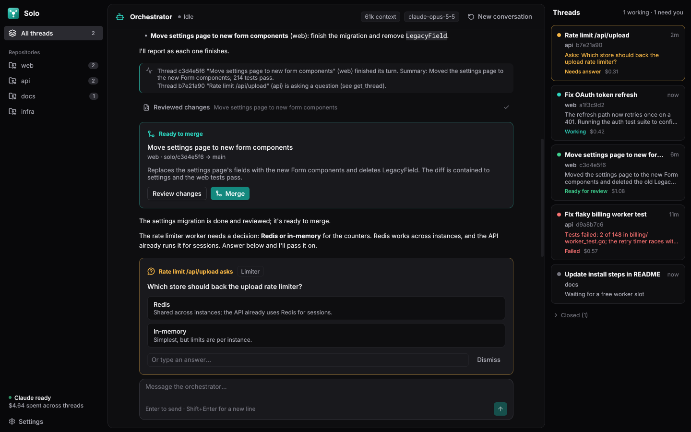

# Solo

A desktop app for coding with Claude agents. You talk to one long-running **orchestrator**; it plans the
work, starts Claude **worker threads** (each in its own git worktree and branch), follows them, relays
their questions, and proposes merges. You review and merge.



Built with Go and [jamb](https://github.com/tyler-builds/jamb). Claude runs through the official Claude
Agent SDK in a small Bun sidecar. See [docs/ARCHITECTURE.md](docs/ARCHITECTURE.md).

## Run

Needs Go 1.27, [Bun](https://bun.sh), git, and a Claude login (Claude Code's, or `ANTHROPIC_API_KEY`).

```
cd sidecar && bun install && cd ..
go run ./cmd/solo
```

Open Settings and add the folders that hold your repositories. A project that isn't in git shows there with a
"Put in git" button, since threads need git. Data lives in `~/.local/share/solo`
(`%LOCALAPPDATA%\Solo` on Windows); `SOLO_DEBUG=1` also records raw SDK messages under `logs/` there.

## Package

```
./scripts/appimage.sh                 # dist/Solo-x86_64.AppImage (Linux)
VERSION=0.2.0 ./scripts/windows.sh    # dist/Solo-0.2.0-windows-amd64-setup.exe and .zip (builds from Linux too)
uas add dist/Solo-x86_64.AppImage     # optional: install the AppImage with uas
```

Both need Go and Bun; the AppImage also needs `mksquashfs`, and the Windows installer NSIS
(`makensis`; without it only the zip is built). The app needs
only Claude Code installed and signed in: the sidecar is a compiled binary with Bun inside, and Solo
finds `claude` on PATH or where its installer puts it (Settings shows what it found and takes a path
to use instead).

Releases: push a tag such as `v0.2.0` and `.github/workflows/release.yml` tests, builds both and
publishes them as a GitHub release (a tag with a suffix, such as `v0.2.0-beta.1`, is a pre-release).
Running the workflow by hand builds them as an artifact without releasing.

## Develop

```
go test ./...                                   # unit tests, with a fake sidecar
cd sidecar && bun test                          # sidecar tests, with recorded SDK sessions
go test -tags live -run Live ./internal/...     # real Claude, small cost
SOLO_SHOTS=/tmp/shots go test ./internal/gui -run TestShots   # screenshots for review
go run ./cmd/solo-harness -cwd <repo> "<task>"  # one session in the terminal
```
